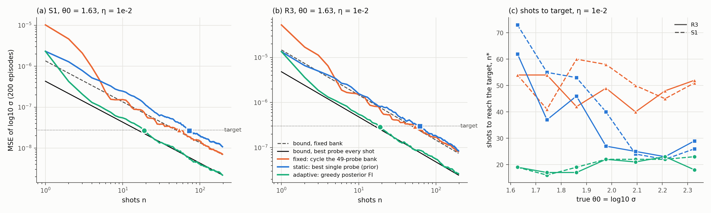
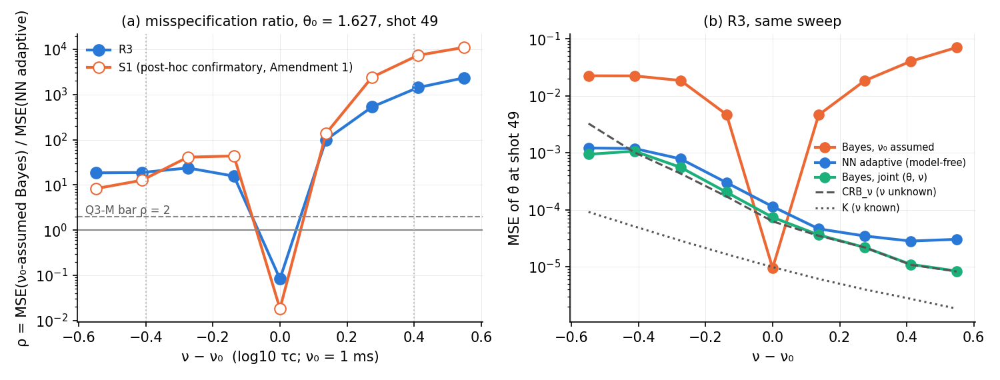

# ML-adaptive quantum estimation on the NMR engine

Build: an **estimation/metrology yardstick** (Fisher information and the Cramér–Rao
bound, CRB) and an **adaptive controller**, on top of the validated open-system engine.
The simulation shares its sequence definitions and gradient paths with the future
hardware loop, so it acts as a digital twin of that loop.
Simulation is preparation; the publishable result is the hardware demonstration.

Each stage is pre-registered in this file (systems, ranges, probe bank, readout + D,
thresholds, advance prediction) and committed **before** its data are generated.
Results are appended below each frozen pre-registration and never edit it.

**Status:**

- Module C done.
- Module A done; its unit-test gate passed.
- Stage 1 done (pre-registered `4d75d11`): **Gate Y PASS, Q1 NO, as predicted.** The M0 estimators are 3–4 orders of magnitude from the CRB; the readout keeps the information; the MLE attains the bound (§2.9).
- Module B arm (i) built: `app/qrc/adaptive.py`, tests pass.
- Stage 2 done (pre-registered `99f56de`): **Gate F, Q2a, Q2b PASS; Q2c FAIL (prediction miss: the adaptive gain over the best static probe is at the low-θ edge).** About 2.5× fewer shots than the fixed bank. A v1 posterior-grid bug was fixed and rerun as a disclosed deviation (§3.9).
- Batched GPU episode runner: `app/qrc/adaptive_batch.py` (1-D, and a 2-D joint (θ, ν) posterior for Stage 3).
- Module B arm (ii) built: `app/qrc/neural_policy.py` (model-free neural estimator + REINFORCE policy).
- Stage 3 PRE-REGISTERED (§4): model-free adaptive estimation with τ_c hidden. Primary = misspecification contrast at the low-θ edge (Q3-M: ρ ≥ 2 at Δν ≥ 0.4, both systems), vs a ν₀-assumed Bayesian baseline; joint (θ, ν) Bayesian and nuisance CRB_ν as references. η = 10⁻¹, 49-bank; continuous action deferred to Stage 3b. Predicted: Tier A, Q3-M, Q3-M2, Q3a, Q3b PASS. **Result (§4.10): R3 passes every test (Q3-M median ρ = 722); S1 is VOID (gate A2: joint-posterior cap hits 7.5% > 5%), so the overall verdict is not decided.** **Amendment 1 (§4.6, post-hoc confirmatory): fixed joint-Bayes posterior (v3b) re-run on S1 only → A2 0.5%, A1b 0.86 PASS; S1 Q3-M 3695 (carried over) corroborates; S1 Q3a 0.13 fails (Tier C).**

---

## 1. Modules

### 1.1 Module C — sequences as an engine primitive (`backend/app/qrc/sequences.py`)

- **What it is.** `Sequence` is an ordered tuple of `Pulse(axis, angle)`, `Delay(t)` and
  one final `Acquire(n, dwell)`.
- **Simulation.** Simulators execute it through a four-method backend:
  `init / pulse / free / acquire`.
- **Hardware.** A driver consumes the same object via `to_dict()`: an event list with
  absolute start times and RF phases. `from_dict` round-trips it.
- **Builders.** `cpmg(n_pi, T, n_acq, dwell)` is the M0 probe; `fid_delay` and
  `inversion_recovery` are the M1 kinds.
- **M0 now uses it.** `qrc_noisespec_m0.Batch.probe` runs `sequences.cpmg` through
  `sequences.run`.
- **Regression test** (`backend/tests/test_qrc_sequences.py`). The refactored probe equals
  a frozen copy of the pre-refactor code to ≤ 1e-12 relative, on S1 and R3, for
  N_π ∈ {0, 1, 4, 32}.
- **Not ported.** M1's `Propagator` (transverse regime, closed VOID) keeps its own
  step-count builder.

### 1.2 Module A — estimation yardstick (`backend/app/qrc/estimation.py`)

- **Measurement model.** A probe returns a deterministic ensemble signal μ(θ, probe),
  observed with additive Gaussian noise. Complex signals are real-ified as (Re, Im).
- **Fisher information.** FI = Jᵀ C⁻¹ J, with J = ∂μ/∂θ. J comes from autograd or from a
  4th-order central difference. FI adds over probes. CRB = FI⁻¹.
- **Functions.**
  - `classical_fisher(signal_fn, theta, probes, sigma | cov, method)`
  - `cramer_rao`, which raises on a singular FI
  - `linear_readout_fisher(J, M, sigma)`: the FI left after a linear readout F = M y,
    which bounds every estimator built on that readout
  - `report_vs_bound(estimates, θ, CRB)`: bias, variance, MSE, CRB/Var and CRB/MSE.
    A result below the bound is flagged; only a biased estimator can get there.
  - `m0_sigma(η, A) = ηA/√2`, the per-component noise std of the M0 convention
- **QFI.** Not implemented yet (the spec marks it as optional and later).

**Unit-test gate** (`backend/tests/test_qrc_estimation.py`, 8 tests): **PASSED.**

| Check | Required | Measured |
|---|---|---|
| Single-parameter analytic Gaussian CRB, complex decaying line, finite difference | < 1% | 3.7e-12 relative |
| Same, autograd | < 1% | exact (0.0) |
| Two-parameter (rate, amplitude) analytic FI matrix | < 1% elementwise | pass |
| Efficient linear-model MLE, Monte Carlo (M = 4·10⁵), Var vs 1/FI | within 1% | CRB/Var = 0.9994 |
| Two-parameter linear-model MLE covariance vs FI⁻¹ (M = 2·10⁵) | within 2% elementwise | pass |
| Nonlinear Gauss–Newton MLE at high SNR (M = 4000) | within 7% (≈ 3 s.e.) | pass |
| `linear_readout_fisher` | invertible map is lossless; compression never gains; equals the full-covariance form | pass |
| Singular FI | raises | pass |

### 1.3 Module B — adaptive controller

Arm (i) is built in `backend/app/qrc/adaptive.py`.

- **Posterior.** `GridPosterior` holds an adaptive 1-D grid that re-centres on the posterior. It is updated from the Gaussian sufficient statistics S_j = Σy and n_j, so it re-grids without replaying history.
- **Policies.** `FixedCycle` (the bank), `GreedyFisher` (posterior-expected one-shot FI, Bayesian D-optimal) and `GreedyEIG` (Monte Carlo expected information gain).
- **Episodes.** `run_episode`.
- **Tests** (`backend/tests/test_qrc_adaptive.py`, 3 tests): the posterior matches the closed-form linear-Gaussian posterior (std to 1e-3); the greedy policy picks the max-FI probe; posterior variances reach 1/(n FI_max) for greedy and 1/(n mean FI) for the cycle, to 1e-3.

Arm (ii), the RL / neural policy, is built in `backend/app/qrc/neural_policy.py` (Stage 3, §4.3).

---

## 2. Stage 1 — yardstick: do the existing estimators reach the CRB? (PRE-REGISTRATION, frozen)

**Regime: commuting σz dephasing.** [L0, Lz] = 0, so the exact M0 fast path applies
(asserted at generation). No transverse noise and no class-mixing control.

### 2.1 Question

For **one** parameter, a known model and the fixed 49-probe M0 bank: does the variance (and
MSE) of the existing M0 estimators reach the CRB? The existing estimators are the ridge on
M0 features and the MLP on M0 features. The answer sets the gap that Stages 2–3
(adaptive and learned) must close.

### 2.2 Systems, parameter, noise

- **Systems.** S1 (C2 alone, on resonance) and R3 (crotonic C1–C3, protons decoupled).
  Both are exactly `qrc_noisespec_m0.make_systems()`.
- **Injected noise.** H = (ξ/2) Σσz, with ξ one OU component. It is an exact Lorentzian
  realised as a collapsed telegraph sum with N = 20 levels and solved exactly with the
  SLE, as in M0a.
- **Correlation time.** **τ_c = 1 ms, known.**
- **Parameter.** **θ = log10 σ** (σ in rad/s). Prior U[log10 30, log10 300], the M0a
  σ range.
- **Probe bank.** M0's 49 probes, N_π ∈ {0, 1, 2, 4, 8, 16, 32} × T ∈ {2, 5, 10, 20, 50,
  100, 200} ms, each built by `sequences.cpmg`. Acquisition is 512 points at 50 µs. One
  measurement record = one shot of all 49 probes.
- **Measurement noise.** M0 convention: complex white noise, std ηA/√2 per real
  component. A = noiseless |S(0)| after the π/2 pulse, per system: A_S1 = 0.05,
  A_R3 = 0.15.
  - η ∈ {1e-3, **1e-2 (primary)**, 3e-2, 1e-1}.
  - Noise comes from fixed seeds (`noise_seed` in the runner). Each test point uses
    M = 2000 realisations, drawn in chunks of 250.

### 2.3 Bound

- **Definition.** The CRB at θ0 is 1/FI(θ0), where FI is that of the **raw complex FID**
  of the full bank: 49 × 512 complex values, **D_raw = 50,176 real**.
- **Derivative.** J is a 4th-order central difference with step h = 1e-3 in θ, on
  complex128 noiseless FIDs at θ0 + h·{−2, −1, 1, 2}.
- **Method validation, done before this commit and disclosed.**
  - The FI is step-independent to < 1e-9 for h ∈ {5e-4, 1e-3, 2e-3}.
  - Bound values were computed at θ0 ∈ {1.627, 1.977, 2.327}, η = 1e-2: √CRB =
    1.6e-4, 6.4e-5, 4.3e-5 (S1) and 5.5e-4, 1.8e-4, 1.2e-4 (R3).
  - No estimator output on Stage 1 data has been seen.
- **Readout-limited bounds** (descriptive). The FI that survives the linear feature
  maps `lines-lin` and `time-lin` (`linear_readout_fisher`). This separates information
  lost by the readout from inefficiency of the estimator. The log families are
  nonlinear, so they get no exact readout bound.

### 2.4 Test points and estimators

- **Test points.** θ0 = 7 values evenly spaced in [log10 30 + 0.15, log10 300 − 0.15], so
  they stay in the interior and away from the prior edges, where prior-trained regressors
  are biased by truncation.
- **E0 — MLE, known model (reference).**
  - Gaussian likelihood on the raw FID.
  - Grid argmin over a model grid of 801 points spanning the prior (complex128), then
    Gauss–Newton on the 6-point Lagrange interpolant of the model, clipped to the prior.
  - It uses the full raw readout, **D = 50,176**.
  - Validated on an analytic model before this commit: CRB/Var = 1.006, bias −0.013 √CRB.
- **E1 — ridge (existing).** `qrc_noisespec_m0_analysis.ridge_method`.
  - Family ∈ {lines-lin, lines-log, time-lin, time-log} and α ∈ logspace(−4, 4, 17),
    chosen by 5-fold CV on train.
  - Train set: 1200 θ ~ prior (seed 501), each with its own measurement noise at the
    same η.
  - Selection and D are recorded per cell. D values:
    - S1: lines-lin 98, lines-log 49, time-lin 3136, time-log 1568
    - R3: lines-lin 1176, lines-log 588, time-lin 3136, time-log 1568
- **E2 — MLP (existing).** `mlp_method`: the same features and train set, and the M0 grid
  (hidden (128,128) or (256,256), L2 ∈ {1e-4, 1e-2}) with 3-fold CV.
- **Readout labelling.** These are the M0 noise-spectroscopy readouts, labelled with D
  above. They are **not** the forecasting SOP's 653-feature proton FID spectrum. That SOP
  readout belongs to the 9-spin forecasting reservoir and does not apply to these 1- and
  3-spin ¹³C sensing systems.

### 2.5 Metrics

At each (system, η, θ0) the metrics are: bias, Var, MSE, **e_mse = CRB/MSE** (primary)
and e_var = CRB/Var. The summary statistic is the median over the 7 test points.

### 2.6 Thresholds

**Gate Y (yardstick validated on the simulator).** For η ∈ {1e-3, 1e-2} and both
systems, at every θ0, all of the following must hold:

- E0 has e_var ∈ [0.9, 1.1]. This is ≈ 3 s.e. at M = 2000.
- E0 has |bias| ≤ 0.2 √CRB.
- The noiseless MLE offset, |MLE(μ(θ0)) − θ0| (the interpolation error), is ≤ 0.1 √CRB.

If Gate Y fails, Stage 1 is **VOID**: the CRB machinery is not validated on the
simulator, so no estimator is compared with it.

**Q1 (primary).** Per (system ∈ {S1, R3}) × (estimator ∈ {E1, E2}): the estimator
"reaches the CRB" iff median e_mse ≥ 0.8 at η = 1e-2.

Descriptive (no threshold):

- the other η levels;
- the readout-limited bounds;
- the R3 / S1 ratio of the CRB;
- the bias profile.

### 2.7 Advance prediction

- **Gate Y: PASS.**
- **Q1: NO for all four cells, and far from it.**
  - The M0a ridge reached R² ≈ 0.97, which is an RMSE of order 10⁻² in log10 σ.
  - The pre-commit √CRB is about 10⁻⁴.
  - Predicted: ridge median e_mse < 10⁻², MLP median e_mse < 10⁻¹.
  - The readout is not the main cause: the predicted lines-lin readout bound is within
    a factor of 10 of the raw CRB. The estimators are the bottleneck.
  - Consequence: the yardstick shows a gap of at least two orders of magnitude between
    the R²-style estimators and the bound. Stages 2–3 are then about closing it with
    fewer measurements or without knowing the model, not about beating a known-model MLE.

### 2.8 Persistence

`backend/artifacts/traces/qrc_adaptive_stage1_{S1,R3}.npz` holds the following, all
noiseless, all written **before** any metric:

- test-point FIDs and FD stencil FIDs (complex128);
- the MLE model grid (801, complex128);
- the train FIDs (1200, complex64);
- θ values, seeds, probes, A, dwell and `meta`.

Measurement noise is regenerable from fixed seeds. Results go to
`docs/QRC/data/qrc_adaptive_stage1_results.json`.

Runner: `backend/scripts/qrc_adaptive_est.py stage1-gen --system {S1,R3}`, then
`stage1-analyze --prereg <commit>`. It runs on CPU, about 10 min (S1) and about 20 min (R3)
for generation.

---

### 2.9 Stage 1 results (appended; pre-registration `4d75d11` unchanged)

Runs: generation on CPU, 283 s (S1) and 705 s (R3). Analysis on CPU, 1939 s.
Data: `docs/QRC/data/qrc_adaptive_stage1_results.json`.
Traces: `backend/artifacts/traces/qrc_adaptive_stage1_{S1,R3}.npz` (0.58 GB each, gitignored).

**Gate Y: PASS (all 4 cells).**

- E0 (known-model MLE) has CRB/Var between 0.93 and 1.07 at every test point and every η,
  including the descriptive η levels.
- Its bias is within 0.2 √CRB.
- The noiseless interpolation offset is ≤ 3·10⁻⁹ √CRB.
- So the yardstick is validated on the simulator: the bound is attainable, and the MLE
  attains it.

**Q1: NO for all four cells, as predicted.**

| η = 10⁻² | √CRB (mid θ0) | MLE CRB/MSE | ridge CRB/MSE | MLP CRB/MSE | ridge pick (D) | MLP pick (D) |
|---|---|---|---|---|---|---|
| S1 | 6.4e-5 | 1.00 | **1.5e-4** | **1.7e-3** | lines-lin (98) | lines-log (49) |
| R3 | 1.8e-4 | 1.01 | **5.6e-4** | **4.2e-4** | lines-lin (1176) | lines-lin (1176) |

Each CRB/MSE value is the median over the 7 test points.

At every η (descriptive):

- The ridge sits 10⁻⁶ to 2·10⁻² of the bound.
- The MLP sits 2·10⁻⁵ to 3·10⁻² of the bound.
- Both sit at an RMSE of order 10⁻² in log10 σ, almost flat in η.
- The bound and the MLE scale as η (Fig. AE1).

The gap therefore grows as the measurement improves.

**Where the information goes (descriptive, readout-limited bounds).**

- **`lines-lin` keeps all of it.** Its bound is 1.05× the raw CRB (S1) and 1.00× (R3).
  This is the readout both systems' ridges selected.
- **`time-lin` costs a factor of 16** in variance, which is exactly its 32/512
  subsampling.

So the estimators had the information and did not extract it. **The whole gap is the
estimator, not the readout.** This matches the prediction (the readout bound is within
10×).

**Bias.** It dominates the ridge error: bias² is 35–86% of the MSE. A linear map cannot
follow the nonlinear θ → signal relation. The MLP's error is mostly variance on R3 (bias²
1–6% of MSE) and mixed on S1 (17–96%).

**R3 vs S1.** Under the M0 noise convention (noise ∝ total signal A), the R3 √CRB is about
2.9× the S1 value. Three spins add no information per unit of noise about this
collective dephasing. This is consistent with the M0 symmetry argument.

**Verdict.**

- The M0 R²-style estimators are **3–4 orders of magnitude** from the CRB at the primary
  noise level.
- The readout keeps the information.
- A known-model MLE closes the gap entirely.
- Stage 2 therefore asks about *measurements*: whether adaptive probe choice reaches the
  bound with fewer shots.
- Stage 3 asks about *model knowledge*: whether a learned policy and estimator
  approach the bound without the known model, where the MLE cannot be built.

Fig. AE1: `docs/QRC/figures/figAE1_stage1_crb.png` (code
`docs/QRC/figures/code/qrc_adaptive_stage1_figure.py`). The `lines-lin` readout bound is
not drawn because it coincides with the raw CRB.

---

## 3. Stage 2 — adaptive, known model: is the CRB reached in fewer shots? (PRE-REGISTRATION, frozen)

**Regime:** commuting σz dephasing, as in Stage 1. The model is fully known (θ only
unknown, τ_c known).

### 3.1 Question

Does Bayesian-adaptive probe choice (Module B arm (i)) reach the CRB **in fewer shots**
than cycling the fixed 49-probe bank? Does it beat the best *static* single-probe design?

This is textbook Bayesian experimental design. It is the known-model baseline that Stage 3
must match without the model. It is not a novelty claim.

### 3.2 Setup

- **Systems, θ, prior, noise model, η convention:** as in Stage 1 (§2.2).
- **η.** **10⁻² (primary)**; 10⁻¹ descriptive.
- **Shot.** One execution of one probe (`sequences.cpmg`) gives one 512-point FID.
- **Readout per shot: z = y @ Q.** Q is an orthonormal basis (QR) of the line-phasor span
  `ma.phi(system)[+1]`, the same span as the Stage-1 `lines-lin` readout.
  - D = 2L real per shot: S1 L = 1 (D = 2), R3 L = 12 (D = 24).
  - Q is orthonormal, so the noise stays white with the same σ = ηA/√2. Simulating z
    directly is exactly equivalent to simulating y and projecting.
  - FI retained vs the raw FID: 93–98% for S1 and 99.1–99.7% for R3. This was computed
    before this commit and is disclosed.
  - All bounds below are for this readout.
- **Model.** The Stage-1 noiseless grid (801 points), projected, with the 6-point Lagrange
  interpolant (validated in Stage 1 Gate Y).
- **True signals.** The Stage-1 test-point FIDs, projected.
- **Posterior.** `GridPosterior`: uniform prior on [log10 30, log10 300], 201-point grid
  re-centred to mean ± 10 std. The estimate is the posterior mean.

### 3.3 Policies (shots chosen one at a time, n = 1…196 = 4 bank cycles)

- **fixed-cycle:** probes 0, 1, …, 48, 0, … (the Stage-1 bank, shot by shot).
- **greedy-fisher:** each shot uses argmax_j of the posterior-averaged one-shot FI.
- **static-best:** always the single probe with the largest prior-averaged one-shot FI.
  This is a good non-adaptive design.
- `GreedyEIG` is built but not run here (cost). It is out of scope for Stage 2.

### 3.4 Episodes, seeds, persistence

- **Episodes.** R = 200 per (system, η, θ0, policy), at the 7 Stage-1 test points θ0.
- **Seeds.** Shot noise comes from `default_rng([700000, sys, ie, j, r])`. It is
  **common across policies** (paired comparison).
- **Persistence.** Per-shot posterior mean, std and chosen probe go to
  `backend/artifacts/traces/qrc_adaptive_stage2_{S1,R3}_eta{η}.npz` **before** any metric.

### 3.5 Bounds and metrics

- **Per-probe FI.** FI_j(θ0) is the one-shot FI of probe j in the z readout. It comes from
  the Stage-1 FD stencil, divided by σ².
- **Bank bound.** B_bank(n) = 1/(n · mean_j FI_j): cycling the bank, n shots.
- **Locally optimal bound.** B_opt(n) = 1/(n · max_j FI_j). This is the best any policy can
  do with n shots, because the per-shot FI is at most max_j FI_j.
- **MSE.** MSE_p(n) = mean over the 200 episodes of (posterior mean − θ0)².
- **Efficiencies.** e_opt = B_opt(196)/MSE_p(196); e_bank = B_bank(196)/MSE_p(196).
- **Shots to target.** n*_p = smallest n with MSE_p(n') ≤ B_bank(49) for all n' ≥ n. The
  target B_bank(49) is the bound of one full bank record; n* is reported as "none" if it
  is not reached by 196.

### 3.6 Thresholds (η = 10⁻², per system)

The gate:

- **Gate F (sanity).** Median over θ0 of e_bank(fixed-cycle) ∈ [0.8, 1.25]. The posterior
  mean must be efficient for the bank. If it fails, Stage 2 is VOID.

The questions:

- **Q2a (greedy reaches the bound).** Median over θ0 of e_opt(greedy) ≥ 0.8.
- **Q2b (fewer measurements, primary).** Median over θ0 of n*_fixed / n*_greedy ≥ 1.5.
- **Q2c (adaptivity, not just a good probe).** At the edge test point θ0 = 2.327 (where the
  best probe differs most from the prior-optimal one), MSE_static(196) / MSE_greedy(196) ≥ 1.5.

### 3.7 Disclosed before this commit

These are bound values only; no Stage-2 episode data were generated:

- per-probe FI at the test points;
- the max/mean FI ratio: 2.0–3.1 (S1) and 2.0–3.0 (R3);
- the best probe moves from a 200 ms free delay at low σ to a 10 ms free delay at high σ;
- the FI-retention numbers above;
- two dev timing episodes at θ = 1.9, which is not a test point (seed 12345, not recorded).

### 3.8 Advance prediction

- **Gate F: PASS.**
- **Q2a: PASS** on both systems.
- **Q2b: PASS** on both. The ratio n*_fixed / n*_greedy should be about the FI max/mean ratio,
  predicted in [1.5, 3.2]. The greedy pays a few shots while the posterior is wide.
- **Q2c: PASS** on both systems.
- The adaptive gain on this bank is **modest (≈ 2–3× in shots)**. The bank already
  contains near-optimal probes for every θ, so the possible gain is capped by the FI
  max/mean ratio, and adaptivity's other contribution is only to track the θ-dependent
  best probe.
- Larger gains would need a richer action space, such as continuous T or N_π. That is
  noted for Stage 3, not tested here.

Runner: `backend/scripts/qrc_adaptive_est.py stage2-run --jobs 12`, then
`stage2-analyze --prereg <commit>`. CPU only, about 45 min.

### 3.9 Stage 2 results (appended; pre-registration `99f56de` unchanged)

**Verdict.** In both systems:

- **Gate F: PASS.**
- **Q2a (greedy reaches the bound): PASS.**
- **Q2b (fewer measurements): PASS.** About 2.5× fewer shots, inside the predicted [1.5, 3.2].
- **Q2c: FAIL.** This misses the prediction. The adaptive gain over the best static probe
  is at the *low*-θ edge, not at the pre-registered high edge θ0 = 2.327.

These are the v2 numbers. The frozen v1 run had a posterior implementation bug that
corrupted S1 at η = 10⁻²; it is reported below and was rerun as a disclosed deviation.

#### v1: the frozen protocol as run, and the bug

The frozen v1 scoring is in `docs/QRC/data/qrc_adaptive_stage2_results.json`.

- **R3: clean.** Gate F PASS (1.07), Q2a PASS (1.03), Q2b PASS (2.47×), Q2c FAIL (1.13).
- **S1 at η = 10⁻²: corrupted** at the four highest θ0, where one shot is very informative.
  - **What went wrong.** After a single shot, all posterior weight landed on one point of the
    201-point grid. The std was then 0, the re-centring step was skipped
    (`b − a < 1e-14`), and the grid never zoomed in again. The estimate froze on a grid point.
  - **Effect on the metrics.** Greedy and static MSE came out around 10⁻⁶, against 10⁻⁹ for
    fixed-cycle. At θ0 = 2.327, which happens to lie exactly on the prior grid, the MSE was
    exactly 0. So the S1 verdict was NaN for Q2b and an artefact (inf) for Q2c.
  - **Not affected:** S1 at η = 10⁻¹ and R3. Their posterior std never fell below the grid
    spacing.
- **Fix (v2).** `GridPosterior.update` now uses the half-width width·max(std, spacing). It
  zooms in until the std is at least 3 grid spacings, with at least 2 passes as before.
  - A regression test, `test_posterior_resolves_peak_narrower_than_prior_grid`, fails on v1
    and passes on v2.
  - Everything else is unchanged: seeds, episodes, policies, metrics, thresholds.
  - All four (system, η) cells were rerun with tag `_v2`.

#### Compute

- **v1:** numpy/joblib, on .167 (S1, R3 η = 10⁻²) and on cira3 (R3 η = 10⁻¹).
  - R3 η = 10⁻² was computed twice, on .167 and on cira3, with chunked tasks. The two copies
    agree: every probe choice is identical, and the means differ by at most 1.6·10⁻¹¹.
- **v2:**
  - S1 ran on cira3 with numpy.
  - R3 ran on the cira3 A100 with the batched torch runner `app/qrc/adaptive_batch.py`
    (17 s per 200-episode cell).
  - That runner uses the same seeds. Against the numpy v2 code, the means agree to within
    2·10⁻¹¹ and every probe choice is identical.
- **Traces:** `backend/artifacts/traces/qrc_adaptive_stage2_{S1,R3}_eta{0.01,0.1}{,_v2}.npz`.

#### v2 results

From `docs/QRC/data/qrc_adaptive_stage2_v2_results.json`. Medians are over the 7 θ0.

| system | η | e_bank(fixed) | e_opt(greedy) | n* fixed / greedy (median) | static / greedy MSE₁₉₆ at θ0 = 1.63 … 2.33 |
|---|---|---|---|---|---|
| S1 | 10⁻² | **0.97** | **0.98** | **2.56×** | 4.94, 3.85, 2.73, 1.73, 1.19, 1.00, **1.16** |
| R3 | 10⁻² | **1.07** | **1.03** | **2.47×** | 3.23, 2.78, 2.19, 1.81, 1.23, 1.00, **1.13** |
| S1 | 10⁻¹ | 1.04 | 1.05 | 2.21× | 5.01, 3.85, 2.73, 1.73, 1.19, 1.00, 1.16 |
| R3 | 10⁻¹ | 0.95 | 1.02 | 2.32× | 3.32, 2.82, 2.41, 1.87, 1.07, 1.00, 0.99 |

Shots to the target (MSE ≤ the one-bank-record bound) at η = 10⁻², for θ0 = 1.63 … 2.33:

| system | policy | n* |
|---|---|---|
| S1 | fixed | 54, 41, 60, 58, 50, 45, 51 |
| S1 | greedy | 19, 16, 19, 22, 22, 22, 23 |
| S1 | static | 73, 55, 53, 40, 24, 22, 26 |
| R3 | fixed | 54, 54, 42, 49, 40, 48, 52 |
| R3 | greedy | 19, 17, 17, 22, 21, 23, 18 |
| R3 | static | 62, 37, 46, 27, 25, 23, 29 |

*Fig. AE2.* (a, b) MSE vs shots at θ0 = 1.63, η = 10⁻². The adaptive policy (green) follows
the best-probe-every-shot bound B_opt after about 3 shots. The fixed bank follows its own bound
B_bank, and the static design follows a bound for a probe that is wrong for this θ0. Markers
show n*. (c) n* vs θ0 for both systems.

#### Reading

1. **Q2a/Q2b (as predicted).** With the model known, greedy posterior-FI design is
   efficient: e_opt is 0.78–1.13 per point. It needs about 2.5× fewer shots than cycling the
   bank, ranging 1.9–3.2× per point.
   - This matches the bank's FI max/mean ratio (2.0–3.1) disclosed before the run.
   - The gain is capped by the action space, as predicted. The bank already contains
     near-optimal probes.
2. **Q2c (missed).** The pre-registration assumed the best probe differs most from the
   prior-optimal one at the high edge, θ0 = 2.327. That is wrong.
   - The prior-optimal static probe is the right probe at high θ (ratio 1.0–1.2).
   - It is badly wrong at low θ, where adaptivity is worth 3.2–5.0× in MSE.
   - The test point was mis-chosen; the effect itself is there. Per the protocol, Q2c is
     reported as FAIL.
3. **What Stage 2 establishes.** It is a known-model baseline only (textbook Bayesian design;
   no novelty claim). Stage 3 has to approach it **without** the model. The headroom beyond
   it lies in a richer action space (continuous T / N_π), not in better probe choice from this
   bank.

---

## 4. Stage 3 — model-free adaptive estimation under noise-model uncertainty (PRE-REGISTRATION, frozen)

**STATUS: FROZEN before any test-grid data.** The commit that adds this section is the
pre-registration commit (2026-10-27).

- The 20k-step R3 training pilot on **random practice points is complete**. **No test-grid
  episode has been run.**
- Practice-point results were used to calibrate the thresholds below. This is legitimate:
  the freeze is before *test-grid* data, and practice data is what sets sensible numbers.
- Each prediction is tagged **[pilot-calibrated]** (practice data exists) or **[advance]**
  (untested).
- Nothing in §§4.1–4.5 may change after the first test-grid episode. The discipline is the
  same as Stage 1 (§2, `4d75d11`) and Stage 2 (§3, `99f56de`).

*Revised from a v0 draft to reflect the finished pilot:*

- *primary η = 10⁻¹, which matches the trained model;*
- *the nuisance-marginalised CRB as the bound;*
- *continuous action deferred to Stage 3b.*

*Placeholders were filled, and two definitions were corrected, before the freeze (§4.6).*

**Units convention (hard rule).** All efficiencies and ratios are in **MSE (variance)**,
labelled `(MSE)`. RMSE = √MSE is quoted only for intuition. Do not mix conventions at
scoring.

**Regime.** Commuting σz dephasing, as in Stages 1–2 (fast path asserted at generation,
commutator ≤ 1e-10). One OU component (collapsed telegraph), exact SLE.

### 4.0 What is new vs Stage 2, and the claim

Stages 1–2 were **known-model**: the noise correlation parameter was fixed and given to every
method. Stage 3 removes that.

- **What changes.** A second noise parameter, **ν**, varies and is **hidden from the learned
  methods**.
- **What is not being asked.** Whether a neural policy can beat a *correct* model. Stage 1
  settled that it cannot and need not: a known-model MLE attains the CRB.
- **The claim under test is robustness:**

> *A learned (model-free) adaptive policy matches a model-aware baseline when the model is
> right, and **beats it when the model is wrong**.*

The **pre-registered primary endpoint is the misspecification contrast** (Tier B). Absolute
bound-matching (Tier C) is secondary.

**Design lock: low-θ operating point.** Stage 2 (Q2c) showed that the value of adaptivity
concentrates at the low-amplitude edge (3–5×), so the primary operating point is the low-θ
edge, chosen in advance. Continuous action, the second intended lock, is **not built** and is
deferred to Stage 3b (§4.8). Stage 3 runs on the discrete 49-bank.

### 4.1 Frozen configuration

| Item | Value |
|---|---|
| Systems | S1 (single ¹³C, crotonic C2) and R3 (three ¹³C, C1–C3), as in Stages 1–2. **R3 and S1 both count** (see §4.3). |
| **Noise level** | **η = 10⁻¹** only, with σ = ηA/√2 per real component. Any other η needs retraining and a separate freeze. |
| Target parameter | θ ≡ log10 σ (σ in rad/s); prior θ ~ U[log10 30, log10 300] = U[1.477, 2.477] |
| **Nuisance parameter** | ν ≡ **log10 τ_c** (τ_c in s), with OU correlation time τ_c. The true range is **ν ∈ [log10 2·10⁻⁴, log10 5·10⁻³] = [−3.699, −2.301]**: τ_c from 0.2 to 5 ms, 1.4 decades around ν₀. It is drawn uniformly in training and **hidden from the learned methods**. |
| Model-aware assumption | **ν₀ = −3.0** (τ_c = 1 ms, the Stage 1–2 value). It sits exactly on the ν table grid. |
| Primary operating point | low-θ edge, **θ₀ = 1.627** (σ = 42.4 rad/s, 0.15 inside the prior edge; the Stage-2 low test point) |
| Per-shot readout | orthonormal line-phasor basis z = y @ Q (as in Stage 2). **D = 2 (S1), D = 24 (R3)**; label every result with it. This is not the 653-feature forecasting readout; this is estimation. |
| Action space | **discrete 49-bank**: n_π ∈ {0, 1, 2, 4, 8, 16, 32} × T ∈ {2, 5, 10, 20, 50, 100, 200} ms. Continuous action is Stage 3b. |
| Shot budget | **primary endpoint = shot N = 49**, where the joint posterior converges; this matches the Stage-2 one-bank record. |
| Training | Model-free, on simulated prior draws only: B = 1024 episodes per step, 20 000 steps. AdamW, lr 3·10⁻⁴, OneCycle, gradient clip 1.0. Architecture in §4.2. |
| Training: R3 | **complete** (seeds adaptive 910, fixed 911; cira3 A100) |
| Training: S1 | same recipe, seeds 920/921, started on cira3 before this commit. Its training log contains no test-grid data. |
| Model files | `artifacts/models/qrc_adaptive_s3_{sys}_eta0.1_{adaptive,fixed-cycle}_pilot20k.pt` |
| **Primary test set: the ν sweep** | θ₀ = 1.627 × 9 ν values: {−3.549, −3.412, −3.274, −3.137, **−3.000**, −2.863, −2.726, −2.588, −2.451}. So Δν = \|ν − ν₀\| ∈ {0, 0.137, 0.274, 0.412, 0.549} on both sides. |
| **Secondary test set: the grid** | 5 × 5: θ ∈ {1.627, 1.802, 1.977, 2.152, 2.327} × ν ∈ {−3.549, −3.274, −3.000, −2.726, −2.451}. Its θ₀ row is shared with the sweep, giving 29 points in total. |
| True signals | **Engine** FIDs at each point (not the training interpolant). Table vs engine: ≤ 8.5·10⁻⁶ σ (R3) and ≤ 6.1·10⁻⁵ σ (S1). |
| Realisations | **M = 2000** per point for the neural and 1-D Bayesian methods. M = 200 for the two joint (θ, ν) Bayesian methods (cost), using the first 200 of the same episodes. |
| Noise seeds | Shot noise from `default_rng([800000, sys, 10, k, r])`, with k = 0–24 for the grid and k = 25–28 for the sweep extras. It is **paired across all methods**. |

### 4.2 Methods and bounds (all on the per-shot z readout, 49 shots, η = 10⁻¹)

**Methods**

1. **neural-adaptive** (`nn-adaptive`). A learned estimator plus a learned policy over the
   49-bank, with argmax at evaluation. *This is the method on trial.* It is model-free and
   never given ν.
2. **neural-fixed** (`nn-fixed`). The same learned-estimator architecture, trained on the
   fixed 49-cycle with no policy. It isolates the policy's contribution.
3. **model-aware Bayesian, ν₀ assumed** (`bayes-misspec`). The Stage-2 method: a 1-D grid
   posterior in θ, with greedy posterior-FI probe choice, assuming ν = ν₀. It is strong when
   right; misspecification should break it.
4. **joint (θ, ν) Bayesian** (`bayes-joint`). It co-estimates ν on a 2-D affine grid posterior
   and chooses probes by greedy Bayesian c-optimal design for θ. This is the fair
   "knows-it-doesn't-know" baseline. `bayes-joint-fixed` is the same posterior on the fixed
   cycle (a sanity reference).
5. **oracle** (`bayes-oracle`). The 1-D Bayesian method at the true ν. Descriptive only.

**Neural networks** (`app/qrc/neural_policy.py`):

- **Inputs.** Sufficient statistics for Gaussian shot noise: per-probe mean ȳ_j/A, n_j/N,
  a visited mask, and t/N.
- **Estimator.** MLP, 512 hidden units, 4 layers, LayerNorm + SiLU, outputs (θ, ν). Trained
  with a per-step normalised MSE.
- **Policy.** MLP, 256 hidden units, 3 layers, trained by REINFORCE.
  - Reward: −mean log err² at shots {12, 24, 49}.
  - Baseline: a privileged critic V(θ, ν), used in simulation only.
  - Entropy bonus 10⁻³.

**2-D posterior** (`BatchedEpisodes2D` v2):

- An affine 41 × 41 grid with a window of about ±7 posterior std.
- Shrink ≤ 2× per pass; the window doubles if the boundary-ring mass exceeds 10⁻⁶.
- Zoom passes are capped at 30. The cap-hit fraction is logged per shot (`unresolved2d`).

**The bound: the nuisance-marginalised CRB.** ν is unknown and must be co-estimated, so the
yardstick for a model-free method is *not* the known-ν CRB.

1. Form the one-shot joint Fisher matrix F_j over (θ, ν) for each probe j:
   F_j = Re(J_jᴴ J_j)/σ², with J_j = [∂μ_j/∂θ, ∂μ_j/∂ν] taken from stored central-difference
   stencils, h = 10⁻³.
2. Take the best design over the bank:

   CRB_ν(θ) = (1/N) · min over ξ of [(Σ_j ξ_j F_j)⁻¹]_θθ, with ξ a design on the 49-bank.

   This is the c-optimal design. It needs ≤ 2 support points and is found by brute force
   over pairs × 1001 weights. For any design, [I⁻¹]_θθ = 1/(I_θθ − I_θν²/I_νν) ≥ 1/I_θθ.
3. This is a *local* bound: its optimal design depends on the unknown (θ, ν). It is the
   target an ideal adaptive policy approaches.
4. Also used:
   - the **known-ν bound** K(θ) = 1/(N max_j F_θθ,j), for a method that knows ν;
   - the fixed-bank nuisance bound [(mean_j F_j)⁻¹]_θθ / N.

**Metrics** (all at shot 49, in MSE, from the posterior mean or network estimate):

- MSE(method, θ₀, ν) = the mean over the M realisations of (θ̂ − θ₀)².
- **Misspecification ratio.** ρ(Δν) = MSE(bayes-misspec) / MSE(nn-adaptive), as a function
  of Δν = |ν_true − ν₀|.
- **Nuisance efficiency.** e_ν = CRB_ν / MSE.
- **Adaptive contribution.** r_adapt = MSE(nn-fixed) / MSE(nn-adaptive).

### 4.3 Tiers, thresholds, predictions

Each test is scored per system. **Overall verdicts need both systems to pass.**

**Tier A — sanity gates.** All must pass, or that system's stage is **VOID**.

| Gate | Requirement | Prediction |
|---|---|---|
| **A1a — the model-aware baseline is strong when right** | At the 5 well-specified grid points (ν = ν₀), median K / MSE(bayes-misspec) ∈ [0.8, 1.25] (MSE). Against the **known-ν** bound: at ν = ν₀ this method *is* the known-ν method (see §4.6, correction 1). | **PASS [pilot-calibrated]**: the same machinery at the true ν gave 0.98–1.14 on the dev points. |
| **A1b — the joint baseline reaches the nuisance bound** | Over the 25 grid points, median CRB_ν / MSE(bayes-joint) ∈ [0.8, 1.25] (MSE). | **PASS [pilot-calibrated]**: dev points 0.86–1.01. |
| **A2 — the posterior converges at the endpoint** | Joint (θ, ν) zoom-cap hit fraction at shot 49 is **≤ 5%** (the maximum over all points and both joint policies). The fraction is reported. | **PASS [pilot-calibrated]**: 0% at shot 49 on the dev points. The shots 2–16 ridge is disclosure-only (§4.4). |
| **A3 — no leakage** | The test points are disjoint from the training draws. | **PASS (procedural).** Training samples (θ, ν) continuously from the prior through the interpolation table only. The engine test signals are never loaded by `train`. |

**Tier B — misspecification contribution (PRE-REGISTERED PRIMARY).**

| Test | Requirement | Prediction |
|---|---|---|
| **Q3-M (primary)** | On the θ₀ = 1.627 sweep, at the far end (**Δν ≥ 0.4**: the 4 points ν ∈ {−3.549, −3.412, −2.588, −2.451}): median ρ ≥ **2.0** (MSE), both systems. | **PASS predicted.** **[advance]** at θ₀ = 1.627. Practice data exists only at other θ: dev points 1 and 2 (θ = 1.96 and 1.59, Δν = 0.105 and 0.585) gave ρ = 44 and 1850 (MSE) at 20k steps. The ν₀-wrong model is systematically biased; the model-free policy is not. Caveat: at the short-τ_c end CRB_ν is large at low θ (R3 RMSE 0.057 at ν = −3.549), so this end is the harder side. |
| **Q3-M2** | A finite crossover exists on **each side** of ν₀. Δν* is the smallest Δν at which ρ reaches 1, linear in log ρ between sweep points; Δν* = 0 if ρ ≥ 1 already at ν₀. Both values are reported. | **PASS predicted [advance]**; Δν* small to moderate (≲ 0.15). |

**Tier C — against the bound** (secondary; a reported quantity, not a binary disaster).

| Test | Requirement | Prediction |
|---|---|---|
| **Q3a** | nn-adaptive's nuisance efficiency, at the 5 well-specified grid points (ν = ν₀). Pass bar: median e_ν ≥ **0.3** (MSE). The achieved e_ν is the result. | **PASS predicted [pilot-calibrated]**, but close. Dev e_ν was 0.20–0.60 at 20k steps, at points near but not at ν₀. A model-free estimator within about 1.3–2.2× RMSE of the nuisance-aware bound is reportable, not a fail. |
| **Q3b** | The learned **policy** helps: median r_adapt ≥ **1.5** (MSE) over the 25 grid points. | **PASS predicted [pilot-calibrated]**: dev 1.9–9.5× (MSE). |

**Descriptive (no threshold):**

- ρ over all 20 off-centre grid points;
- e_ν of nn-adaptive at all points, and of bayes-joint;
- bayes-joint / nn-adaptive (MSE);
- oracle vs K;
- MSE vs shots;
- probes chosen;
- `unresolved2d` per shot.

### 4.4 Disclosed limitations (frozen; reported with the results)

- **Joint (θ, ν) posterior at early shots.**
  - After a few shots of one probe, the (θ, ν) posterior is a thin curved ridge that an affine
    grid cannot capture. Zoom is capped at 30 passes and the cap-hit fraction is logged.
  - The primary endpoint is at shot 49, where the posterior converges and sits near the bound
    (pilot). Early-shot (< 25) numbers for the joint methods are reported **for disclosure
    only** and used in no pass/fail test.
  - No SMC or ridge-frame rewrite is required for the primary.
- **The joint methods use M = 200**, not 2000 (cost: about 460 s per R3 point at M = 200).
  They enter only A1b, A2 and descriptive numbers, never Tier B.
- **No continuous action in Stage 3.** The bank's max/mean FI ratio (2.0–3.1 in Stage 2) caps
  the achievable adaptive gain. This is stated so that a near-ceiling result is not spun.
- **η = 10⁻¹ only.**
- **Training budget.** 20k steps; the adaptive training curve was still falling at 20k (item 3
  of §4.7). The verdict is for this budget.
- **Pilot ≠ test grid.** Pilot (practice) numbers calibrated the thresholds; the frozen verdicts
  are decided only on the untouched test points.

### 4.5 Decision rule

- **Any Tier A gate fails** → that system's stage is **VOID**. Fix the baseline or posterior,
  and re-freeze before any further test data.
- **Tier A passes and Q3-M passes** → the contribution: *model-free adaptive estimation is
  robust to noise-model misspecification, beating a model-aware baseline where the model is
  wrong.* The ρ(Δν) crossover figure is the key figure.
- **Q3a** → reported as the achieved e_ν, framed as *how close a model-free policy gets to the
  nuisance-aware bound*. Stage 1 explains why it need not reach it.
- **Q3-M fails** → honest negative: on this platform, the learned policy's robustness does not
  exceed a model-aware baseline within 49 shots at η = 10⁻¹. Report it; no post-hoc
  reframing.

### 4.6 Corrections to the v1 draft, made before the freeze

1. **Gate A1 split into A1a and A1b.**
   - As drafted, A1 measured the ν₀-assumed method at ν = ν₀ against CRB_ν. That method *knows*
     ν there, so its MSE approaches the known-ν bound K < CRB_ν. Its e_ν would then be ≫ 1.25
     by construction; on the R3 sweep at ν₀, (0.0079/0.0031)² ≈ 6.4.
   - A1a therefore uses K.
   - The draft's parenthetical ("joint posterior already near the bound") is A1b, the joint
     method against CRB_ν.
2. **CRB_ν needs a design.** Σ_probe JᵀC⁻¹J depends on which probes are run. It is defined
   as the best (c-optimal) design over the bank, the quantity the pilot efficiencies were
   computed against.
3. **Q3-M was tagged [advance — not piloted].** Practice-point ρ values exist (dev 1 and 2),
   but not at θ₀ = 1.627. The tag now says so.
4. **Placeholders filled:** ν, its range, ν₀, θ₀, the test sets, M, seeds, the A2 threshold
   (5%) and the far-end cut (Δν ≥ 0.4).
   - The sweep adds 4 midpoint ν values at θ₀ (`gen-sweep`; engine signals and stencils,
     2026-10-27). They are noiseless signal templates, not episodes.
   - Medians "over the grid" are over the 25 grid points. Tier B uses the 9-point sweep.
5. **S1 models did not exist** (only a 2-step smoke test). They are trained with the R3
   recipe before the S1 evaluation.

### Amendment 1: S1 un-void (2026-10-28, after S1 was voided at commit `98d4be2`)

**Trigger.** S1 was voided under the frozen Tier A rule.
- Gate A2 requires the joint (θ, ν) Bayesian zoom-cap hit fraction at shot 49 to be ≤ 5%. It
  failed at one sweep point (7.5%).
- There were also isolated non-converged points; at one of them, MSE was about 2000× the bound.

**What failed: a reference-method tooling issue, not a defect in the claim.**
- The joint (θ, ν) Bayesian method is a *reference* only. It enters gates A1b and A2 and the
  descriptive gap-to-best. It does **not** enter the primary test Q3-M (neural adaptive vs the
  model-aware ν₀ baseline), nor Q3b.
- The ν₀-assumed baseline has ν fixed and no ridge to collapse, so it is unaffected.
- What failed is therefore the convergence of a reference posterior. It is independent of the
  quantities that make up the claim.

**Diagnosis (random practice points only).** Practice points:
- 8 points drawn uniformly in the long-τ_c region (seed 4242);
- 4 points over the whole prior (seed 4243);
- table signals, 200 episodes each, noise keys `[800000, 1, 10, 5000 + k, r]`.

None is a test point. Each episode was compared with the exact posterior on a dense 1201 × 401
grid over the prior box. The frozen posterior (v2: 41 × 41 affine window, 30-pass cap) has two
distinct failures:
1. **Lost mode.** The window zooms onto a wrong mode while the posterior is still broad, and
   cannot see the true mode again. In one practice episode the local posterior mean was 451
   posterior sd from the dense-grid mean.
2. **Thin ridge.** S1 has one complex reading per probe (L = 1), so the posterior is a thin
   ridge that stays narrower than 2 window cells. The convergence test then never passes,
   although the estimate is correct. Cap hits at shot 49 reached 14% on practice points.

A third behaviour is **not** a posterior failure. The myopic greedy-c design sometimes picks a
single probe for all 49 shots, so ν, and with it θ, is never resolved. The local posterior
agrees with the dense one in those episodes.

**Fix (v3b, `BatchedEpisodes2D(n=81, guard=2.0)`, eval `--post2d v3b`).**
- *Mode guard.* On every shot, the log-likelihood is also evaluated at every table node. This
  is exact, because Lagrange interpolation passes through the nodes. If a node beats the best
  window point by more than 2 nats, the window is re-centred on that node, spanning ±7 node
  spacings, and re-zoomed.
- *Finer window.* 81 × 81 points in place of 41 × 41, with the same ±7-sd span.
- Everything else is unchanged:
  - convergence test (≥ 2 cells, ring mass ≤ 10⁻⁶);
  - 30-pass cap;
  - greedy-c criterion;
  - priors;
  - noise.
- Regression tests:
  - the guard is silent on a unimodal posterior and gives identical answers;
  - the node log-likelihood equals the interpolated one at the nodes.

**Validation (practice points only).**

| | v2 (frozen) | v3b |
|---|---|---|
| Cap-hit fraction at shot 49, greedy, max over the 12 points | 14% | 1% (0% at 11 of 12) |
| Cap-hit fraction at shot 49, fixed cycle | 0% | 0% |
| Posterior-mean agreement with the dense grid (5 worst points × 200 episodes) | one episode 451 sd off | none > 3 sd, ≤ 0.5% > 1 sd, max 1.35 sd |

v3a (the guard alone, 41 × 41) fixed the lost mode but not the thin ridge (14%), so it was
rejected.

**Disclosed side effect.** With a correctly resolved posterior, the greedy-c single-probe stall
becomes more frequent at some practice points: 37% of episodes at one point, 8% at another,
against 2% and 0.5% under v2. Under v2, part of the escape from the stall was numerical noise
in an under-resolved posterior. This makes the joint-Bayes *reference* weaker at such points,
so it can lower S1's A1b. That is accepted as the honest consequence of fixing the posterior.
The design rule is **not** retuned.

**Status of the re-run: post-hoc confirmatory, NOT pre-registered.**
- The S1 test points had already been observed when the void occurred.
- A prediction whose test outcome has been seen cannot be restored to pre-registered status.
  This amendment documents the fix but does **not** re-freeze S1.
- All recovered S1 numbers are reported in §4.10 as *post-hoc confirmatory (test points
  previously seen)*. They carry corroborating, not pre-registered, evidential weight.

**Invariance: what keeps the primary claim clean.**
- The fix recomputes **only** the two joint (θ, ν) Bayesian reference arms (bayes-joint,
  bayes-joint-fixed). Command:
  `eval --system S1 --policies bayes-joint-fixed bayes-joint --post2d v3b --R 200 --tag _amend1`.
  It uses the same paired noise as the first 200 episodes of the frozen run.
- These arms enter gates A1b and A2 and the gap-to-best figure.
- All other inputs are carried over **unchanged** from `98d4be2`, through
  `analyze --tag _final --joint-from _amend1`:
  - the neural-adaptive, neural-fixed, ν₀-assumed and oracle arms;
  - **hence Q3-M, Q3-M2, Q3a, Q3b and A1a.**
- Correction to the draft of this amendment: A1a is computed from the ν₀-assumed baseline,
  which is a Q3-M input. It is therefore carried over, not re-run.
- S1's Q3-M median ρ ≈ 3700 is reported unmodified.
- *If the fix were to require recomputing any Q3-M or Q3b input, this amendment would be void
  and Stage 3 would be reported R3-only.*

**Gate-structure lesson (applied forward to Stage 3b, not retroactively here).** Future
pre-registrations will scope each gate to the sub-analyses that use the gated method. A
reference-method convergence issue then gates only A1b, A2 and the gap, not the primary claim.

### 4.7 Disclosed pilot data (practice points only, before this commit)

Everything here used random **dev points** (rng 990, never a test point), on the cira3 A100.

1. **Interpolation.** Table vs engine ≤ 3·10⁻⁷ σ (η = 10⁻², R3, θ201/ν65).
2. **Bounds** at the 29 test points, from `bounds`. At the sweep points, RMSE at shot 49:

   | ν | −3.549 | −3.412 | −3.274 | −3.137 | **−3.000** | −2.863 | −2.726 | −2.588 | −2.451 |
   |---|---|---|---|---|---|---|---|---|---|
   | R3: K | 9.6e-3 | 7.1e-3 | 5.4e-3 | 4.1e-3 | 3.1e-3 | 2.5e-3 | 2.0e-3 | 1.7e-3 | 1.4e-3 |
   | R3: CRB_ν | 5.7e-2 | 3.2e-2 | 2.1e-2 | 1.3e-2 | 7.9e-3 | 5.9e-3 | 4.7e-3 | 3.3e-3 | 2.9e-3 |
   | S1: K | 2.5e-3 | 1.9e-3 | 1.5e-3 | 1.2e-3 | 9.4e-4 | 7.6e-4 | 6.1e-4 | 5.2e-4 | 4.6e-4 |
   | S1: CRB_ν | 1.9e-2 | 1.1e-2 | 7.1e-3 | 4.0e-3 | 2.5e-3 | 1.9e-3 | 1.3e-3 | 9.5e-4 | 8.2e-4 |

   Over the 25-point grid (median RMSE at shot 49):
   - R3: K 1.1e-3, CRB_ν 2.7e-3, bank-with-ν-unknown 8.3e-3;
   - S1: 4.3e-4, 8.4e-4 and 2.8e-3.
3. **Pilot training (R3).** Final RMSE is prior-averaged, on the last batch.

   | run | seeds | adaptive | fixed |
   |---|---|---|---|
   | 3k steps | 900/901 | 0.019 | 0.030 |
   | **20k steps** (the models used here) | 910/911 | 0.0137, still falling (entropy 1.0, about 8 probes used) | 0.0275, flat after about 15k |

4. **Pilot evaluation, R3, 3 dev points, M = 200.**
   - Traces: `qrc_adaptive_stage3_eval_R3_eta0.1_pilot{,20k}_dev.npz`.
   - Script: `scripts/qrc_adaptive_s3_devbounds.py`.
   - Each cell is RMSE, then bound / MSE in brackets.

   | method | dev 0 (θ 1.672, ν −3.011) | dev 1 (1.960, −3.105) | dev 2 (1.591, −2.415) |
   |---|---|---|---|
   | oracle (vs K) | 2.6e-3 (1.10) | 1.2e-3 (1.14) | 1.5e-3 (0.98) |
   | joint, fixed (vs bank bound) | 2.6e-2 (0.93) | 1.1e-2 (0.97) | 8.1e-3 (1.11) |
   | joint, adaptive (vs CRB_ν) | 6.8e-3 (1.01) | 3.7e-3 (0.86) | 3.1e-3 (0.92) |
   | ν₀-assumed | 6.0e-3 | 5.2e-2 | 2.8e-1 |
   | nn-fixed, 20k (vs bank bound) | 2.7e-2 (0.84) | 1.3e-2 (0.72) | 8.9e-3 (0.91) |
   | nn-adaptive, 20k (vs CRB_ν) | 8.8e-3 (0.60) | 7.8e-3 (0.20) | 6.5e-3 (0.21) |

   - At 3k steps, nn-adaptive was 2.5e-2, 1.6e-2 and 2.7e-2.
   - The joint posterior hit the zoom cap in up to 45% (adaptive) / 70% (fixed) of episodes at
     shots 2–16. That fell to 0% by shot about 25, and was 0% at shot 49.
5. **Bug fixed before this commit: 2-D posterior v1 → v2.**
   - v1 used a window of about 1 std, so every shot ran 80 zoom passes.
   - A v1 dev run was stopped unfinished; no results.
   - A convergence assertion was added to `test_batched_2d_posterior_matches_closed_form`.
6. **S1.** A 2-step plumbing smoke test only (N = 6, 2 dev points, CPU).

### 4.8 Stage 3b (separate, later pre-registration; stub)

- **Scope.** A continuous action space, T ∈ [2, 200] ms and n_π (integer, relaxed), replacing
  the 49-bank.
- **What it needs.** A (θ, ν, log T, n_π) interpolation table (about 1.3k probes, about 3 GB,
  about 1–1.5 h of A100) plus an interpolation-fidelity pilot.
- **Primary question.** Does continuous action exceed the discrete-bank ceiling,
  n*_bank / n*_cont > 2.56 (the Stage-2 S1 value)?
- **Pre-registration.** On its own, before any 3b test data. (The former Q3-C lives here.)

### 4.9 Runs

All runs are on the lab A100s, GPU only, with ≤ 2 CPU threads (cira CPU is shared).

1. `gen-sweep --system {R3,S1}` (done).
2. `eval --system {R3,S1} --eta 0.1 --model-tag _pilot20k --tag _final` (M 2000 / 200).
   - This writes per-shot estimates, chosen probes and `unresolved2d` to
     `qrc_adaptive_stage3_eval_{sys}_eta0.1_final.npz`, rewritten after every point, **before**
     any metric.
   - Expected: R3 about 6 h, S1 less.
3. `analyze --systems R3 S1 --tag _final --prereg <this commit>`
   → `docs/QRC/data/qrc_adaptive_stage3_final_results.json`.

### 4.10 Results (appended after the run; §4.0–4.9 unchanged)

Pre-registration `0ad42cd`. Runs: cira3 A100, R3 6.9 h, S1 2.1 h (eval), plus S1 training
(2 × 20k steps). Traces `qrc_adaptive_stage3_eval_{R3,S1}_eta0.1_final.npz` were written before
any metric. Numbers from `docs/QRC/data/qrc_adaptive_stage3_final_results.json`. All values
are MSE ratios at shot 49, η = 10⁻¹.

| Test | Bar | R3 | S1 |
|---|---|---|---|
| A1a (K / MSE, ν₀-assumed, well-specified) | [0.8, 1.25] | 0.99 PASS | 1.00 PASS |
| A1b (CRB_ν / MSE, joint Bayes, 25 grid) | [0.8, 1.25] | 0.99 PASS | 0.90 PASS |
| **A2 (joint zoom-cap hits at shot 49, max)** | ≤ 5% | 0.5% PASS | **7.5% FAIL** |
| A3 (no leakage) | procedural | PASS | PASS |
| **Q3-M (median ρ, Δν ≥ 0.4)** | ≥ 2 | **722 PASS** | 3695 (VOID) |
| Q3-M2 (crossover Δν*, below / above ν₀) | finite both | 0.065 / 0.048 PASS | 0.071 / 0.062 (VOID) |
| Q3a (e_ν, NN adaptive, well-specified) | ≥ 0.3 | 0.54 PASS | 0.13 FAIL (VOID) |
| Q3b (r_adapt, 25 grid) | ≥ 1.5 | 3.48 PASS | 1.77 (VOID) |

**Verdict under §4.5.**

- **S1 is VOID.** Gate A2 fails: the joint (θ, ν) posterior hit the 30-pass zoom cap at shot 49
  in 7.5% of realisations at sweep point ν = −2.588, and 5.0% / 3.5% at two grid points (max
  over the 29 points, both joint policies). The same posterior shows isolated failures in S1
  that the median in A1b hides: at (θ, ν) = (2.152, −2.451) bayes-joint's MSE is about 2000×
  CRB_ν. S1's Tier B and C numbers above are shown for completeness and decide nothing.
- **R3 passes every pre-registered test.** Tier A holds, Q3-M (primary) passes by a factor of
  about 360 above the bar, Q3-M2 finds a crossover on both sides, and Q3a and Q3b pass.
- **Overall: not decided.** The pre-registration requires both systems. Per §4.5, the S1
  posterior must be fixed and the stage re-frozen before more test data. Note that A2 concerns
  the *joint* Bayesian reference (it enters only A1b and descriptives), not the two methods in
  Q3-M; that is a reason to fix it, not to reinterpret the rule.

*Fig. AE3.* (a) Misspecification ratio ρ = MSE(ν₀-assumed Bayes) / MSE(model-free NN
adaptive) across the θ₀ = 1.627 sweep, shot 49. Dashed line: the Q3-M bar ρ = 2; dotted
lines: the far-end threshold Δν = 0.4. S1 (hollow) was VOID in the frozen run; after Amendment 1 it
is shown as post-hoc confirmatory (its ρ values are unchanged by the amendment). (b) R3, same sweep: the
ν₀-assumed baseline is best at ν = ν₀ (ρ = 0.08) and is overtaken within Δν ≈ 0.05–0.07,
i.e. about a 12–16% error in τ_c.

**Reading (R3).**

1. **The contribution holds on R3.** A neural policy and estimator trained only on simulated
   priors, never told τ_c, beat the ν₀-assumed Bayesian baseline by 19–2335× in MSE at the far
   end. The baseline's error is a bias floor (MSE 0.02–0.07, i.e. RMSE 0.15–0.27 in log10 σ)
   that does not shrink with shots.
2. **The crossover is small and asymmetric in size, not in position.** The model-aware
   baseline wins only inside |Δν| ≲ 0.05–0.07. On the long-τ_c side the baseline's bias grows
   fast (ρ up to 2335); on the short side ρ saturates near 20, because CRB_ν itself is large
   there and the NN is also limited.
3. **Prior-edge effect at short τ_c.** At ν − ν₀ = −0.55 and −0.41, both the NN and the joint
   Bayes sit *below* the local CRB_ν (panel b). θ₀ = 1.627 is 0.15 from the prior edge
   (1.477); a bounded prior beats a local, unbiased-estimator bound there. These two points
   enter Q3-M only through ρ, which is a ratio of two achieved MSEs, so the verdict is
   unaffected, but e_ν > 1 at such points is not "beating the bound".
4. **Distance to the bound.** Median e_ν = 0.54 at the well-specified points (range over the
   grid 0.10–2.69, the high end being the prior-edge effect). The joint Bayesian method, which
   is given the noise model with τ_c unknown, is about 2.8× better in MSE than the NN
   (bayes-joint / nn-adaptive median 0.36). On the long-τ_c side the NN plateaus near
   3 × 10⁻⁵ while CRB_ν keeps falling to 8 × 10⁻⁶ (panel b).
5. **The policy matters.** r_adapt = 3.5 (range 1.35–9.6): the learned probe choice, not just
   the learned estimator, carries the gain.

**Reading (S1, descriptive only, VOID).** The NN's nuisance efficiency on S1 is low
(e_ν 0.04–0.34; median 0.13 at ν₀), and r_adapt ranges 0.44–5.5. The single-spin model gives
the network less to work with at 20k steps. That is a training-budget or capacity question for
a re-frozen run, not a finding.

**What would un-VOID S1 (proposal, not run).** Replace the affine-grid zoom for the S1 joint
posterior with a version that handles the curved (θ, ν) ridge, e.g. a larger cap plus a
ridge-aligned frame, or SMC; validate on random dev points only; amend and re-freeze; then
re-run the S1 joint-Bayes arms (and, if the amendment says so, the full S1 eval) on the test
points. Re-running on points already seen is a protocol decision and needs the user's go.

#### S1: post-hoc confirmatory (test points previously seen; NOT pre-registered)

> These S1 results were produced after the S1 void (Amendment 1, §4.6). The joint-Bayes
> reference posterior was fixed (v3b) and re-run on test points that had already been observed.
> They **corroborate** the pre-registered R3 result and do not carry pre-registered weight. The
> pre-registered Stage 3 verdict is **R3** (above).

Numbers from `docs/QRC/data/qrc_adaptive_stage3_final_amend1_results.json`
(`analyze --tag _final --joint-from _amend1`). The re-run took 1.0 h on the cira3 A100 and
wrote trace `qrc_adaptive_stage3_eval_S1_eta0.1_amend1.npz`. The script asserts that the
carried-over arms' per-point MSEs are identical to `98d4be2`.

| Test | Bar | S1 (η = 0.1, MSE, shot 49) | Source |
|---|---|---|---|
| Q3-M (primary): median ρ at far-off τ_c | ≥ 2 | **3695** (8–11,026 over the 4 far points) | carried over, unchanged from `98d4be2` |
| Q3-M2: finite crossover each side of ν₀ | finite | Δν* = 0.071 below / 0.062 above | carried over |
| Q3b: gain from learned probe choice | ≥ 1.5 | **1.77** | carried over |
| Q3a: efficiency vs the unknown-ν bound | ≥ 0.3 | **0.13** (reported; below the bar) | carried over |
| A1a (ν₀ baseline vs the known-ν bound) | [0.8, 1.25] | 1.00 | carried over (a Q3-M input; see Amendment 1) |
| A1b (joint Bayes vs the unknown-ν bound) | [0.8, 1.25] | **0.86** (was 0.90 under v2) | re-run (reference) |
| A2 (joint-Bayes cap-hit fraction) | ≤ 5% | **0.5%** (was 7.5%) | re-run (reference) |

**Reading.**

- Q3-M and Q3b are **unchanged** from the frozen run (`98d4be2`). Only the joint-Bayes
  reference (A1b, A2, gap-to-best) was recomputed. The primary comparison never rode on
  re-analysis of seen data.
- **A1b passes on its median, but the median hides a split.**
  - 15 of the 25 grid points sit at 0.81–1.33, and one at 0.40 (θ = 2.327, ν = ν₀).
  - 9 sit at 0.01–0.09. Seven are at ν > ν₀ (long τ_c); the other two are (1.627, ν₀) and
    (2.327, −3.549).
  - Those 9 are the greedy-c single-probe stall predicted in Amendment 1. The myopic design
    keeps choosing one probe, ν is never resolved, and the reference's MSE stays far above
    CRB_ν.
  - The worst point is now 177× the bound (was about 2000× under v2, a lost mode).
  - So on S1 the joint-Bayes reference is a *weak* reference at long τ_c. The descriptive
    gap-to-best (bayes-joint / nn-adaptive median 0.13 in MSE) overstates the reference there.
  - None of this enters Q3-M.
- **Q3a = 0.13** (below the 0.3 bar) is a *reported quantity*, not a gate (Tier C).
  - The model-free policy reaches a smaller fraction of the nuisance bound on the single-spin
    S1 than on R3 (0.54).
  - The simpler system is harder to run efficiently model-free. That is consistent with the
    smaller per-shot readout (L = 1) and the Stage 1 S1/R3 information difference.
- **Boundary sub-bound caveat.** At the shortest-τ_c / low-θ edge, both the neural and the
  joint-Bayes estimators fall below CRB_ν.
  - The CRB bounds *unbiased* estimators. The bounded θ prior induces bias that lowers MSE
    there.
  - Efficiencies at those points are reported with this caveat. They do not affect Q3-M, which
    compares two achieved errors.

**With S1 recovered as confirmatory, both molecules support the primary claim (Q3-M passes).**
R3 carries it as the pre-registered result; S1 corroborates. Tier C Q3a fails on S1 (0.13).
